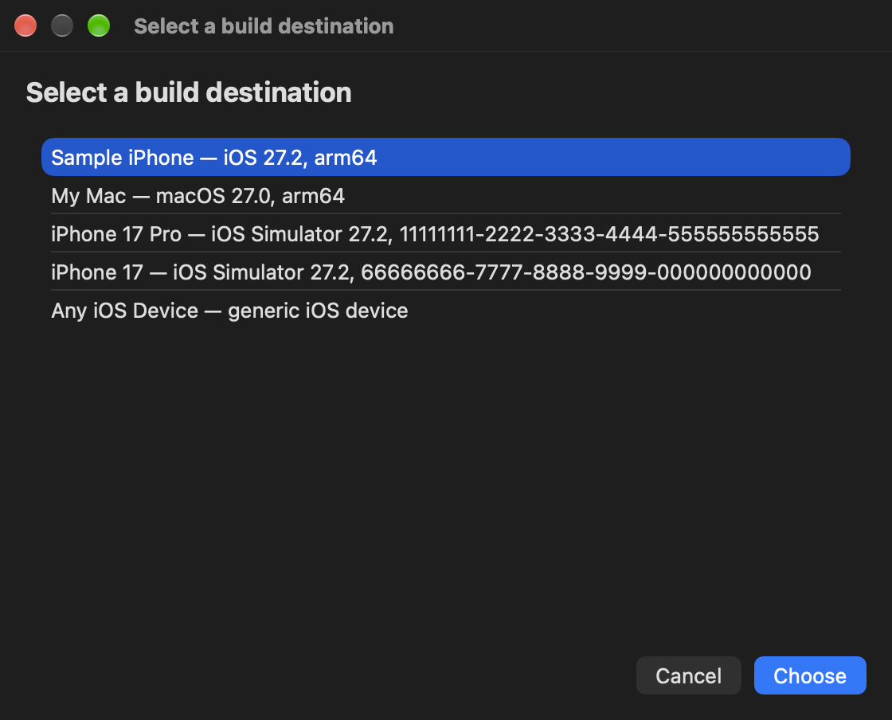
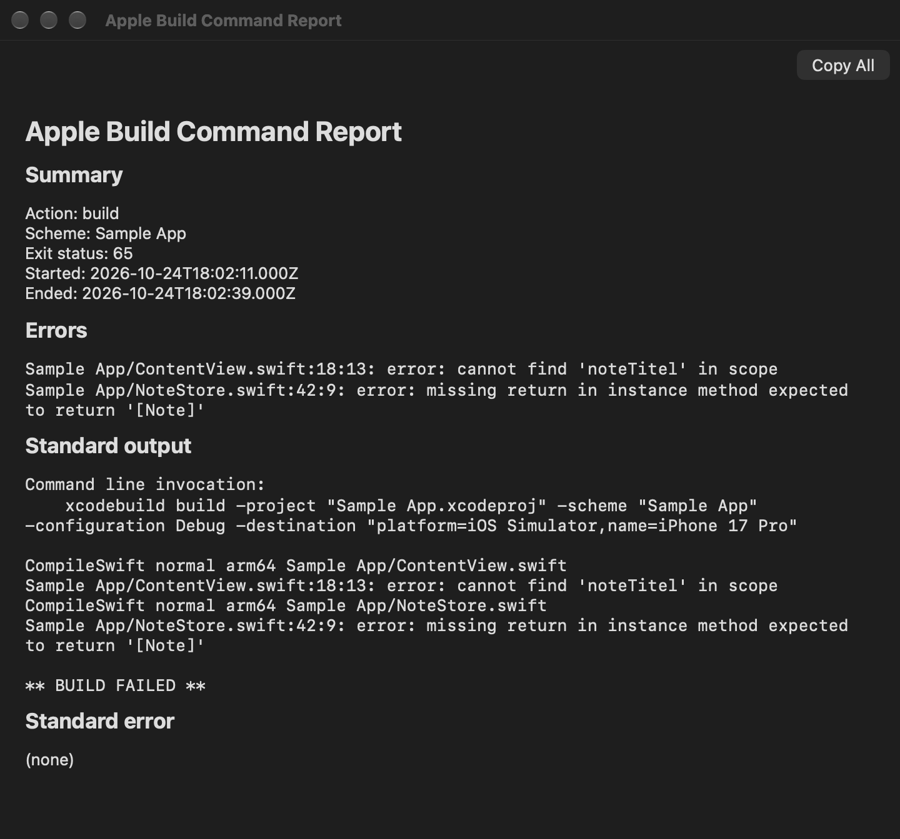
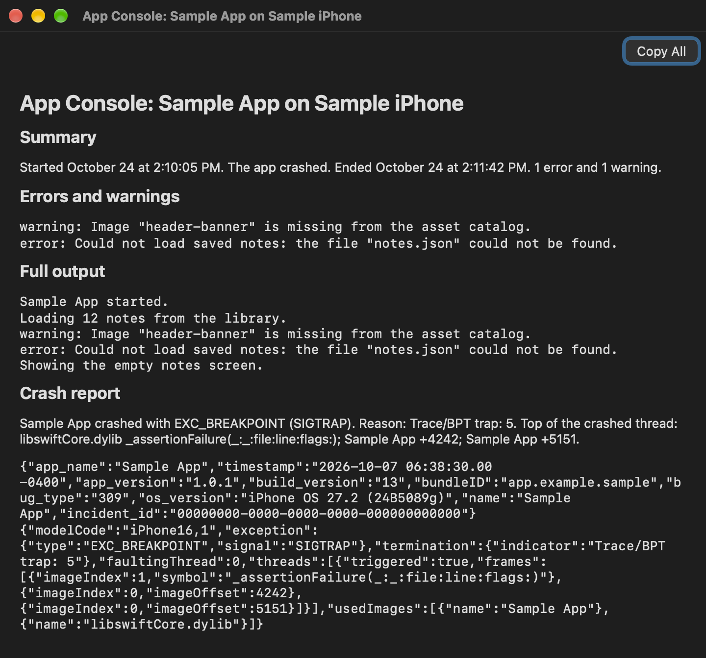
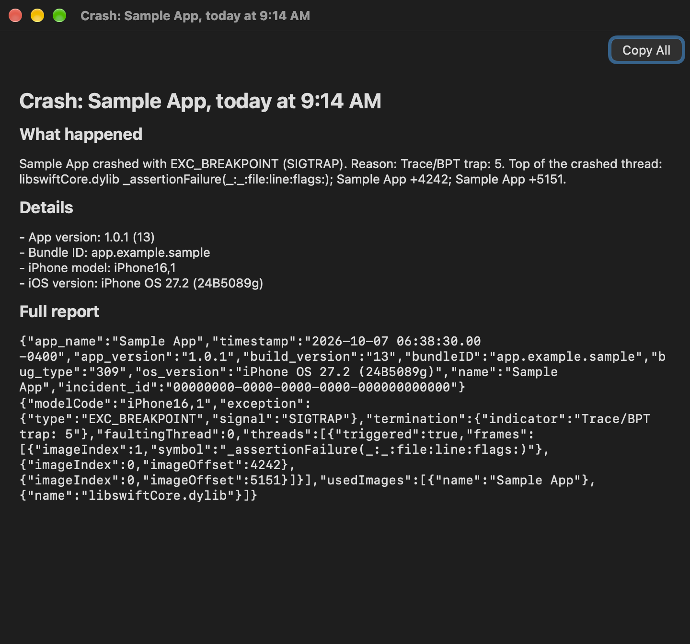

# Apple Build Tools for Nova

A [Nova](https://nova.app) extension for building, running, and testing Apple apps on a Mac, designed from the start for VoiceOver and the keyboard.

Nova had no way to build and run Apple apps, and its command palette is invisible to VoiceOver. This extension fills that gap: everything is reachable from the Extensions menu, and every feature was tested with VoiceOver before it was released.

## What it does

- **Build and Run** on a connected iPhone, on this Mac, or in an iPhone Simulator, as one command from the Extensions menu.
- **App Console**: what your app prints while it runs, with errors and warnings first and the crash report added if it crashes.
- **App Reports**: your app's crash, CPU, and disk-writing reports, listed in plain words.
- **Build reports** that start with the errors, and a result message that names the first error.
- **Build, Clean, and Test**, from the Extensions menu or as Nova tasks.
- **Signing Status** and an Xcode-style **Project Navigator** in Nova's sidebars.
- Every list opens in a small native chooser window that VoiceOver reads. Consoles and reports open in a native reader with real headings and a Headings rotor.

The full guide is in [the extension's README](AppleBuildTools.novaextension/README.md). Nova also shows it in the Extension Library.

## Screenshots

These show a made-up app called Sample App.









## Requirements

- macOS 14 or later
- Xcode, opened at least once so its command-line tools are set up
- [Nova](https://nova.app)
- For iPhone: the iPhone connected and unlocked, trusting this Mac, with Developer Mode on, and a project that can already sign for the device

## Install from source

There is no signed download yet, so you build the extension yourself. It takes a few minutes.

1. Clone this repository and go into it:

   ```bash
   git clone https://github.com/BeckyK102125/apple-build-tools-for-nova.git
   ```

   ```bash
   cd apple-build-tools-for-nova
   ```

2. Build the helper and the reader window. This puts them in `AppleBuildTools.novaextension/Executables`:

   ```bash
   scripts/build-extension.sh
   ```

3. Install it in Nova. This opens the extension in Nova, which asks whether to install it:

   ```bash
   open AppleBuildTools.novaextension
   ```

4. In Nova, open your project's folder, then open **Extensions → Apple Build Tools for Nova** and start with **Apple Build: Select Xcode**.

To update later, run `git pull`, then steps 2 and 3 again.

## Privacy

The extension runs only Apple's own tools (`xcodebuild`, `xcrun`, `devicectl`, `simctl`, `open`, and, only if you turn on spoken alerts, `say`) on your Mac. It does not use the network. Consoles and reports are saved in `~/Library/Logs/Apple Build Tools for Nova/`, never in your project, and only the newest 20 per app are kept.

## Not yet

- Fixing signing, choosing a team, archiving, and uploading to TestFlight or the App Store
- iPhone system logs (messages written with Apple's `Logger`)
- Function names in crash reports (they are shown as addresses for now)
- A signed and notarized download

## Development

The extension is JavaScript in `AppleBuildTools.novaextension/Scripts`. It talks to a Swift helper (`Swift/`) that wraps Xcode's tools and replies in JSON. The reader and chooser window is a small SwiftUI app (`Native/MarkdownReader`).

Run the checks with Node 20 or later and Xcode:

```bash
npm run check-js
```

```bash
npm run test-js
```

```bash
npm run test-swift
```

Bug reports and ideas are welcome in [Issues](https://github.com/BeckyK102125/apple-build-tools-for-nova/issues). If you use VoiceOver or another assistive technology, please say so; that feedback matters most here.

## License

[MIT](LICENSE.md)
